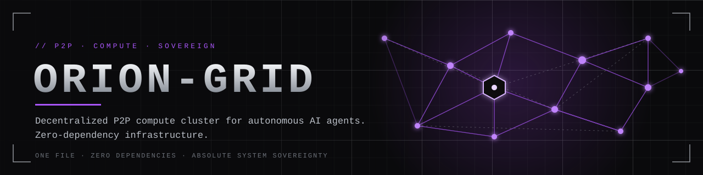

<p align="center"></p>

<p align="center">
<b>High-throughput decentralized P2P network and distributed computing cluster for autonomous AI agents.</b><br>
One file. Zero dependencies. Absolute system sovereignty.
</p>

<p align="center"><code>python &ge; 3.9</code> &middot; <code>stdlib only</code> &middot; <code>asyncio</code> &middot; <code>HMAC-SHA256</code> &middot; <code>~750 lines</code></p>

---

## Why ORION-GRID

| | |
|---|---|
| **Single file** | `orion_grid.py` is the entire system: node, protocol, CLI, benchmark. Copy it, run it. |
| **Zero dependencies** | Pure standard library (`asyncio`, `hashlib`, `hmac`). No pip, no build step, no daemon. |
| **Self-assembling mesh** | Seed one address; peer exchange (PEX) auto-meshes the rest. |
| **Authenticated perimeter** | Mutual challenge-response handshake plus a per-frame *rolling-key* MAC. Rogue nodes are dropped on the first bad byte. |
| **Fan-out propagation** | Events flood the mesh in parallel, TTL-bounded and de-duplicated, with reverse-path acknowledgements. |
| **Self-healing** | Heartbeats, slow-consumer eviction, dead-peer pruning, exponential-backoff reconnect. |
| **Precise telemetry** | Routed packets, active compute nodes, cluster sync latency to 6 decimal places. Non-blocking. |

## Quick start

```bash
export ORION_SECRET=$(python3 orion_grid.py keygen)   # share this out-of-band with every node

# machine A
python3 orion_grid.py serve --port 7777 --id seed-a
# machines B, C, ... (only one seed needed; PEX does the rest)
python3 orion_grid.py serve --port 7777 --seed A_IP:7777

# run a distributed job from anywhere that can reach one node
python3 orion_grid.py submit --seed A_IP:7777 primes --lo 0 --hi 60000000
python3 orion_grid.py submit --seed A_IP:7777 prompt --text "  mail bob@x.io " --stages strip,lower,mask
```

Embed it in an agent runtime:

```python
import asyncio, orion_grid as og

async def main():
    node = og.Node("0.0.0.0", 7777, secret="...", seeds=[("10.0.0.5", 7777)])
    async def summarize(node, payload):          # your own handler
        return {"words": len(payload["text"].split())}
    node.register("summarize", summarize)
    await node.start()
    await node.wait_for_peers(3)
    res = await node.broadcast_event("summarize", {"text": "hello grid"})
    print(res["latency_s"], res["acks"])         # e.g. 0.002151
asyncio.run(main())
```

Handlers are registered **by name**; the wire carries only a kind and JSON data, never code.
Built-ins: `compute` (`prime_count`, `hash_chain`), `prompt_pipeline`, `mask_rules`, `echo`.

---

## Topology

Default behaviour is a **full mesh** (capped by `--max-peers`, default 32). With `--no-mesh`
nodes dial only their seeds and traffic relays hop-by-hop via TTL fan-out.

```
        FULL MESH (default)                   SEEDED LINE (--no-mesh)

        [A]-------[B]                         [A]---[B]---[C]---[D]
         | \     / |                           ^ origin          (TTL relays)
         |  \   /  |
         |   [E]   |                         SEED-STAR BOOTSTRAP -> MESH
         |  /   \  |
         | /     \ |                              [B]   [C]
        [D]-------[C]                              \   /          PEX
                                                    [SEED]  ---->  B<->C<->D<->...
   every node holds a bi-directional,               /   \
   authenticated TCP stream to every peer          [D]   [E]
```

## Connection sequence

```
  INITIATOR (I)                                              RESPONDER (R)
      |  ---- TCP connect ------------------------------------->  |
      |  HELLO   {v, id_I, nonce_I(16B), listen_port}  --------->  |  reject if id_I == id_R
      |  <------- CHALLENGE {id_R, nonce_R,                        |
      |                      proof_R = HMAC(S, "R"|nI|nR|idR|idI)} |
      |  verify proof_R  (R knows S)                               |
      |  AUTH {proof_I = HMAC(S, "I"|nR|nI|idI|idR)}  ----------->  |  verify proof_I (I knows S)
      |                                                            |
      |  K1 = HMAC(S,"K1"|nI|nR)   I->R chain seed                 |  both derive K1, K2
      |  K2 = HMAC(S,"K2"|nI|nR)   R->I chain seed                 |
      |  <=============== rolling-MAC framed session ============>  |
      |  <-- PEERS [(host,port)...] -->      <-- PING / PONG -->   |
```

Duplicate links (simultaneous dial) are resolved deterministically: the connection whose
initiator has the lexicographically smaller node id survives, on both sides.

## Cryptographic perimeter

```
 frame := [u32 length][32B MAC][JSON body]
 MAC_n := HMAC-SHA256( key_n , seq_n || body )          seq_n = implicit per-direction counter
 key_0 := K1 / K2 (per direction, from the handshake)
 key_n+1 := SHA256( key_n || MAC_n )                     <- the "rolling secret"
```

* A forged, replayed, reordered, dropped or truncated frame desynchronizes the chain and fails
  verification. The connection is closed and counted in `auth_drops`.
* Compared with `hmac.compare_digest` (constant time). Frames are capped at 1 MiB.
* Wrong-secret nodes never complete the handshake, so they never receive a single event.

**Threat model, stated plainly:**

1. The perimeter provides **authentication and integrity, not confidentiality**. Payloads are
   plaintext JSON. For hostile networks, run the cluster inside WireGuard/Tailscale/an SSH or TLS
   tunnel.
2. One **shared cluster secret** means anyone holding it is fully trusted. Rotate it by rolling
   restart. Per-node keys and revocation are out of scope for a single-file design.
3. Authenticated peers can only trigger **whitelisted handlers**. `mask_rules` accepts regexes from
   peers (length-capped, but patterns can still be slow); do not expose the secret to untrusted parties.
4. There is no handshake rate limiter. Put the listener behind a firewall allow-list.

## Workload propagation and fault tolerance

```
 origin O                 fan-out (parallel, asyncio.gather)                     acks (reverse path)
   |  EV{eid,ttl=8} --+--> A --EV{ttl=7}--+--> D                                  D -ack-> A -ack-> O
   |                  +--> B --EV{ttl=7}--+--> E        each node:                E -ack-> B -ack-> O
   |                  +--> C                            1. de-dup on eid (LRU 64k)
   v                                                    2. forward to all peers except sender (ttl-1)
 local execute                                          3. execute handler (bounded by semaphore)
                                                        4. ack back along the path the event arrived
```

* **Fan-out first, execute second**: propagation latency never waits on compute.
* **Dead-peer pruning**: no frame for `dead_after` s (default 8) -> evicted. A send blocked for
  >5 s (slow consumer) -> evicted. Pending collections re-evaluate immediately.
* **Reconnect**: known addresses are re-dialed with jittered exponential backoff (0.5 s ... 60 s).
* **Isolation**: handler exceptions become `{"ok":false,"err":...}` acks; they never crash a node.
* **Sharding**: `scatter_primes` splits a range across self + direct peers by sorted node id.
  Use a full mesh (default) for scatter jobs.
* **CPU-bound jobs**: `--workers N` moves `compute` jobs into a process pool, keeping the event
  loop free.

## Telemetry

Every node keeps O(1) integer counters on the event loop (no locks, no I/O in the hot path) and
a reporter task prints a line to stderr every `--stats-interval` seconds (default 5; 0 disables).
`SIGINT` prints the full JSON snapshot.

| Metric | Definition |
|---|---|
| `routed_p2p_packets` | Frames this node **relayed on behalf of others** (event forwards + routed acks) |
| `total_active_compute_nodes` | Live authenticated peers + self (if compute-enabled) |
| `cluster_sync_latency_s` | Origin-side wall time (`perf_counter`, printed `%.6f`) from fan-out start until every expected node has **applied and acknowledged** the event; reported as last / avg / min / max |
| `packets_tx` / `packets_rx` | Authenticated frames sent / received |
| `auth_drops` | Handshakes or frames rejected by the cryptographic perimeter |
| `peers_pruned` | Peers evicted as dead or slow |

Because acks follow handler completion, latency includes handler time. For a pure propagation
measurement use `echo`. By default a collection waits for the origin's direct peers; pass
`expect=N` to wait for N acks from anywhere in a partial mesh.

## CLI benchmarks guide

`bench` builds an N-node cluster **inside one process on loopback**, waits for the mesh to
converge, then fires `--events` broadcasts of `echo` from node 0 and measures sync latency.

```bash
python3 orion_grid.py bench                                   # 8 nodes, 500 events
python3 orion_grid.py bench --nodes 16 --events 300
python3 orion_grid.py bench --nodes 8 --topology line         # multi-hop relay path
python3 orion_grid.py bench --payload-bytes 16384             # bandwidth-heavy events
```

Reference run (Python 3.12, one shared CPU core budget, loopback, 256 B payload):

```
ORION-GRID bench  nodes=8 topology=mesh events=500 payload=256B
  mesh convergence        : 0.254538 s
  sync latency  p50       : 0.002201 s
  sync latency  p95       : 0.003695 s
  sync latency  p99       : 0.004430 s
  sync latency  max       : 0.005726 s
  throughput              : 409.8 cluster-wide syncs/s
  routed P2P packets      : 21000
  total packets sent      : 28000
  timeouts / auth drops   : 0 / 0
```

| Nodes | p50 | p95 | Syncs/s |
|---|---|---|---|
| 8 | 0.002201 s | 0.003695 s | ~410 |
| 16 | 0.010077 s | 0.016205 s | ~87 |

Read these correctly: all nodes share one Python interpreter, so they measure protocol and
crypto cost, not network latency. Real clusters spread the load across processes and add RTT.
Treat the numbers as a baseline for regressions, and re-run on your own hardware.

**Benchmarking a real cluster:** start `serve` on each host, then run
`submit --seed HOST:PORT echo` repeatedly. The JSON includes `latency_s` and the origin's full
telemetry snapshot. Verify distributed correctness with
`submit primes --hi 20000000` (expected 1,270,607).

## CLI reference

```
orion_grid.py keygen
orion_grid.py serve  [--host H] [--port P] [--seed H:P ...] [--id ID] [--max-peers N]
                     [--workers N] [--no-mesh] [--stats-interval S] [--secret|--secret-file]
orion_grid.py submit --seed H:P {echo|primes|hash|prompt} [--lo --hi | --iters | --text --stages]
orion_grid.py bench  [--nodes N] [--events N] [--payload-bytes N] [--topology mesh|line]
```

Prompt stages: `strip`, `lower`, `upper`, `collapse_ws`, `mask`, `truncate:N`.
Distribute masking rules from code with `broadcast_event("mask_rules", {"version": 2, "rules": [{"pattern": "...", "repl": "[X]"}]})`; the highest version wins everywhere.

## Limits

Single-threaded event loop per node. No NAT traversal (open the listen port or use an overlay
VPN). Membership is eventually consistent. Delivery is best-effort flood with at-most-once
execution per node per event id; there is no persistence or replay of missed events.

## License

MIT
